# Pourquoi baromatch.fr ne fait « pas pro » : le diagnostic

Mercredi 25 novembre 2026, sur le site tel qu’il est publié (la branche `main` du jour, servie en local comme GitHub
Pages la sert, puisque la machine de travail ne joint pas baromatch.fr). Captures au téléphone (390 px) et sur
ordinateur (1 440 px) : l’accueil, une page de match (PSG – Rome), la page de Paris, « Pour les bars » et la
Confidentialité. Aucune page n’a été changée.

La mesure de référence : les sites des plus grandes marques grand public (une page produit d’un fabricant de
téléphones, un site de réservation de logements, une appli de musique, une néobanque). Pas les autres sites de foot.
Ce qu’ils ont en commun, et que notre site n’a pas encore : une seule idée par écran, une seule action évidente dès le
premier écran, une image qui donne envie, un seul système visuel du haut en bas, un pied de page discret.

## En une phrase

Le site dit des choses vraies et il est rapide, mais il les dit toutes à la fois : neuf étages de styles différents,
aucune action principale dans le premier écran, un mur de liens pour Google, beaucoup de petit texte et presque aucune
image qui donne envie.

## Les avis du conseiller, vérifiés

| Ce que disait le conseiller | Verdict | La mesure |
|---|---|---|
| L’accueil fait environ 7 000 px sur ordinateur et 7 800 au téléphone, trop d’étages, aucun fil | Confirmé | 6 990 px (7,8 écrans) sur ordinateur, 7 796 px (9,2 écrans) au téléphone ; 8 étages plus le pied de page |
| Pas d’action principale dans le premier écran : « Préviens-moi » n’est qu’un petit bouton du menu | Confirmé | Au téléphone, un bouton à contour de 134 × 44 px dans l’en-tête ; le formulaire commence à 2 350 px (3e écran) |
| Sous le match du soir, un mur de liens soulignés (« Toute la semaine ») qui parle à Google, pas au fan | Confirmé | 50 liens soulignés en 14 px, 261 mots, 773 px de haut au téléphone |
| Les étages changent de style à chaque fois | Confirmé | 5 fonds (papier, nuit, blanc, tableau, nuit du pied), 3 systèmes de titres, 12 rayons d’arrondi différents |
| Beaucoup de petit texte gris et peu d’images qui donnent envie | Confirmé, avec une nuance | 65 % des mots en 15 px ou moins, 73 % dans une encre secondaire ; ce gris reste lisible (contraste 10:1), le défaut est l’absence de hiérarchie, pas la lisibilité. Au téléphone, deux images seulement en dehors des démos (l’album en SVG et le film de 170 px de large) |

## Ce qui fait « pas pro », du plus grave au moins grave

### 1. Aucune action principale dans le premier écran

Au téléphone, le premier écran montre la phrase, une démo du geste à moitié coupée, et le début de la carte du match.
L’inscription, la seule chose qu’un fan peut faire aujourd’hui, est un petit bouton à contour dans l’en-tête, qui
renvoie 2 350 px plus bas. Le premier bouton ambre rempli qu’on voit est « Que faire pour ce match », qui ouvre un
panneau secondaire (messages WhatsApp, un deuxième formulaire caché). Un grand site met son action au centre du
premier écran.

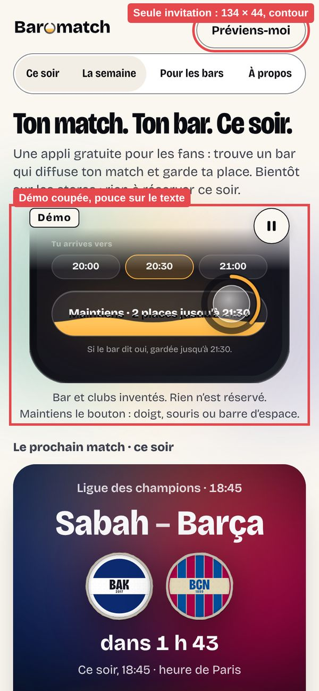
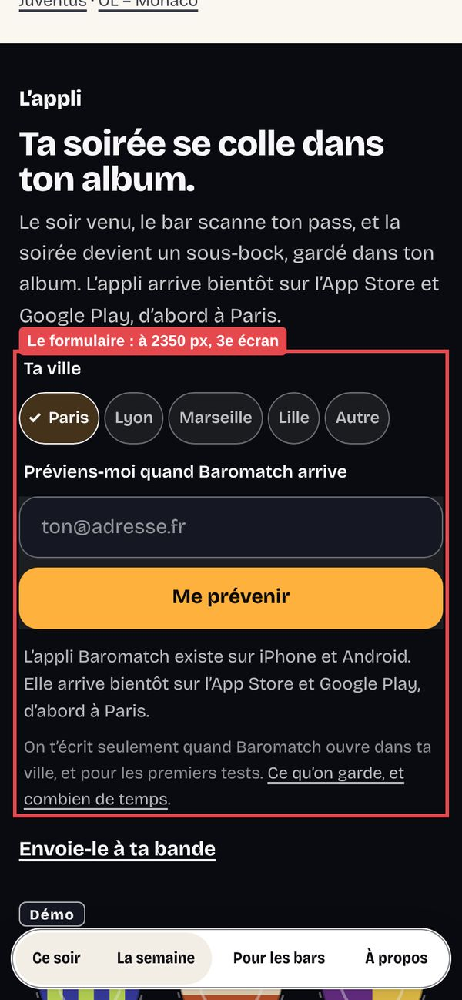
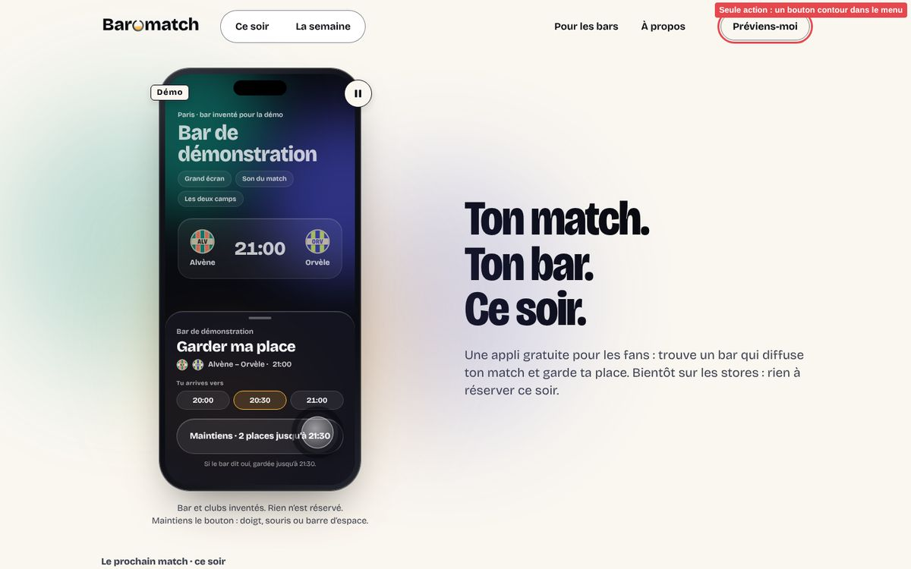

### 2. Pas de fil : neuf étages, trois visiteurs mélangés

L’accueil enchaîne : la démo du geste, le prochain match, toute la semaine, l’appli (formulaire, album, film), les
bars, « Baromatch en bref », le test Android, la FAQ, le pied de page. Le fan, le patron et le journaliste se
croisent à chaque étage ; le même message revient trois fois (l’ouverture, « en bref », la FAQ). 9,2 écrans au
téléphone.

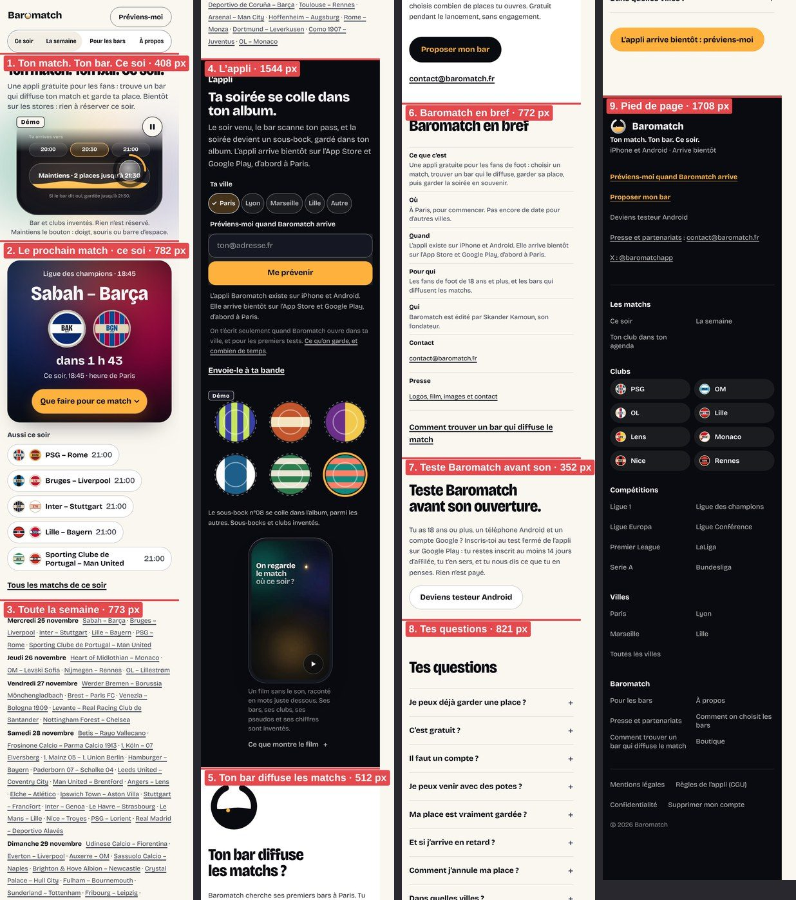
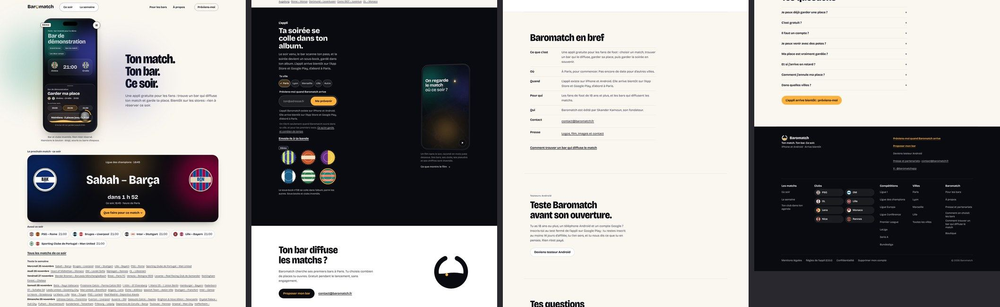

### 3. Pas un seul système visuel

Chaque étage a son propre monde : papier clair, nuit, blanc pur, tableau à deux colonnes, accordéon, pied de page
noir. Trois façons de faire un titre (condensé à 84 % pour l’ouverture, à 88 % pour les sections, une petite
étiquette de 15 à 18 px pour « L’appli » et « Le prochain match »). Douze rayons d’arrondi. D’une page à l’autre aussi :
la Confidentialité est restée en mode nuit avec des liens ambre, « Pour les bars » utilise des cartes blanches
identiques. Une grande marque se reconnaît à ce qu’un écran ressemble au suivant.

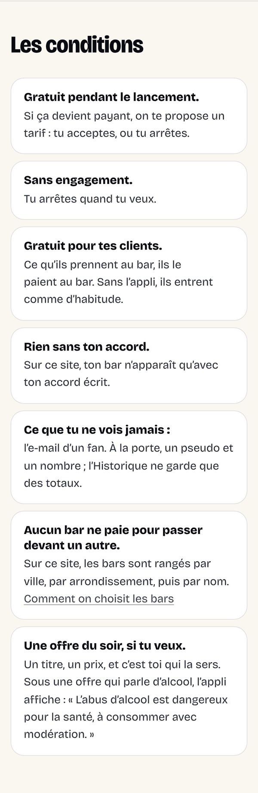
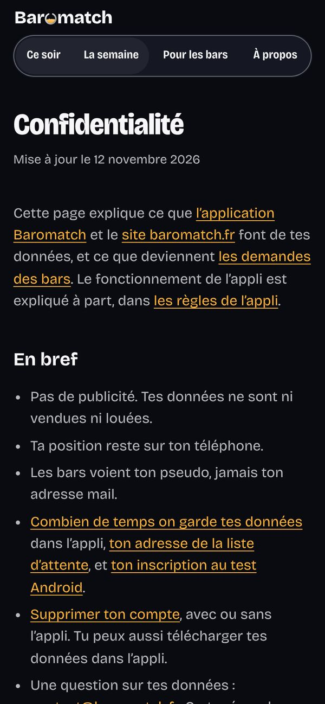

### 4. Rien qui donne envie

Le site n’a pas de direction artistique : pas d’objet, pas de lumière, pas de lieu. Les seules images sont des
démos d’écran (le geste coupé dans le premier écran), un album de six disques plats et un film de 170 px de large
au troisième écran. Les grands sites vendent d’abord une image ; ici, Baromatch a déjà ses objets (le sous-bock, le
verre de lumière, la salle du bar, les insignes des clubs) et ne les montre pas.

### 5. « Toute la semaine » : un mur de liens

Juste sous le match du soir, 50 matchs écrits en liens soulignés de 14 px, séparés par des points, jour par jour. On
lit une page faite pour les moteurs de recherche. Le même contenu, dessiné (les jours, les heures, les couleurs des
clubs), dirait la semaine d’un coup d’œil.

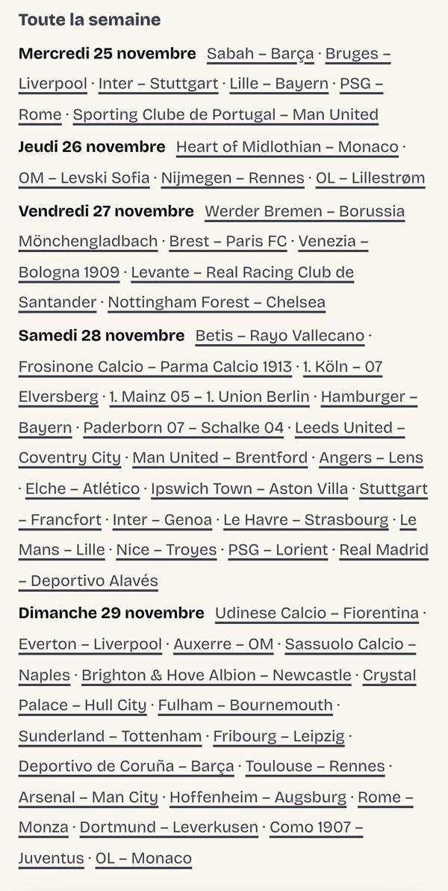

### 6. Un pied de page plus lourd que certaines pages

1 708 px au téléphone, soit 22 % de l’accueil et un tiers d’une page de match ; 40 liens, les clubs en pastilles noires,
deux liens en ambre. Il est le même sur chaque page. Un grand site garde un pied de page court et calme.

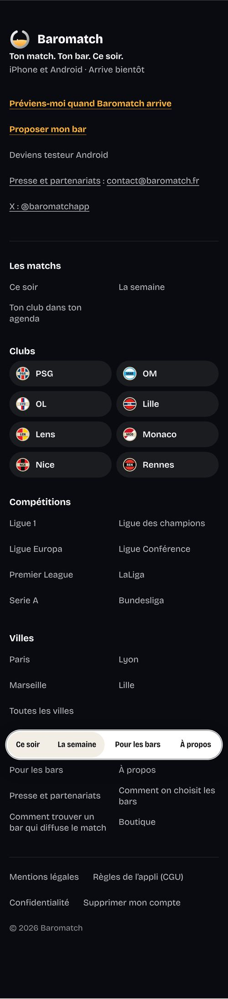

### 7. Beaucoup de petit texte, peu de hiérarchie

65 % des mots de l’accueil sont en 15 px ou moins au téléphone, et 73 % dans une encre secondaire. Les mentions
honnêtes (« Démo », « Bar et clubs inventés », « Rien n’est réservé », « Un film sans le son, raconté en mots juste
dessous ») reviennent à chaque bloc et s’additionnent. Le tableau « Baromatch en bref » redit l’ouverture en petit.

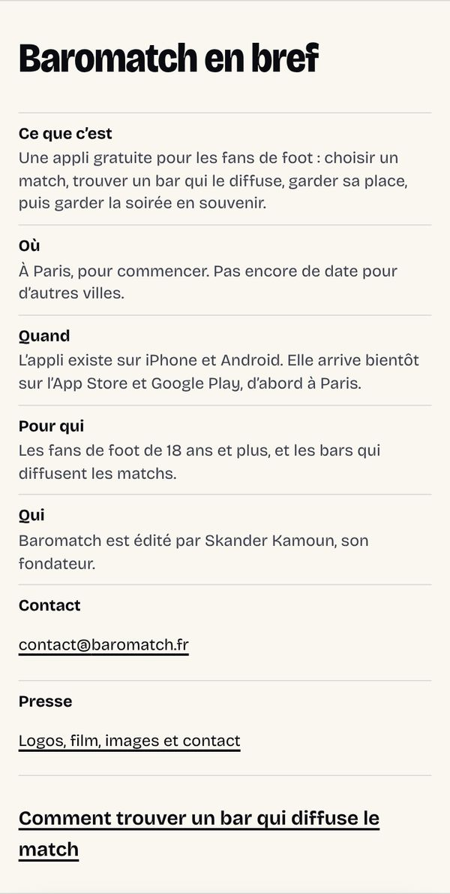

### 8. L’ambre ne désigne plus une seule action

La règle de la marque : l’ambre pour l’action du visiteur et sa place, rien d’autre. Sur l’accueil, au moins six
appels ambre pour trois actions différentes (« Que faire pour ce match », « Me prévenir », « Proposer mon bar » en
texte ambre sur bouton noir, « L’appli arrive bientôt : préviens-moi », deux liens ambre du pied de page), plus la
puce « Paris » cochée. Sur la Confidentialité, tous les liens du texte sont ambre. Quand tout est ambre, plus rien ne
l’est.

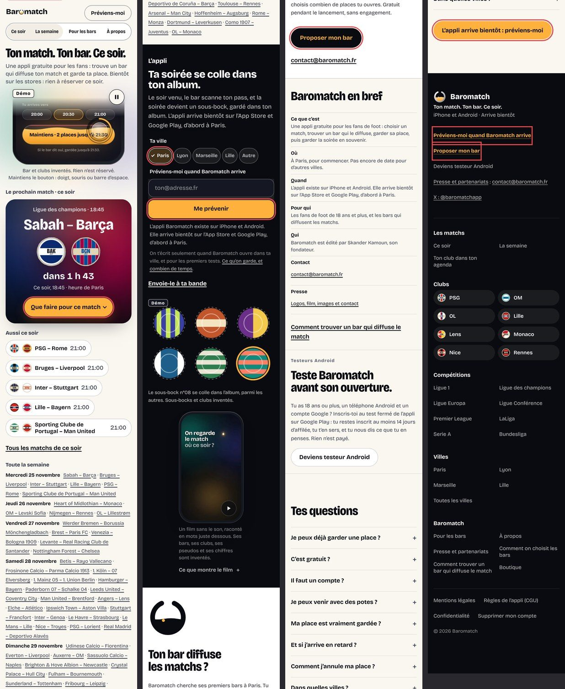

### 9. Une voix typographique de poster de sport

Les grands titres en Bricolage condensé à 84–88 %, très gras, rappellent les affiches de sport et les codes de la
catégorie, que la marque veut justement éviter. La carte du prochain match ajoute un dégradé aux couleurs des deux
clubs et des halos : de la décoration, pas une information. Ce jour-là, l’heure du match sur ce dégradé ne passe pas
le contraste (Lighthouse : accessibilité 97 au lieu de 100, à cause de ce seul texte).

### 10. Les pages générées lisent comme des pages pour Google

Une page de match s’ouvre sur un fil d’Ariane, un lien « English », deux boutons de partage, puis une carte de Paris
de démonstration et « Aucun bar ne l’annonce encore » : la promesse principale est vide avant qu’on comprenne la page.
La page de Paris aligne près de 900 mots, aucune image, et « Pas de soirée annoncée pour l’instant ».

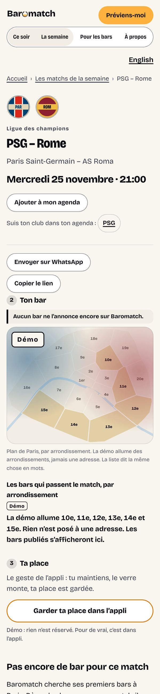
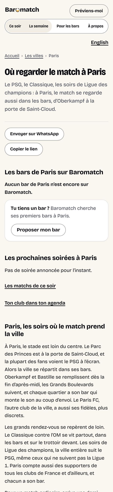

## La lecture « trois visiteurs », au téléphone

- **Le patron de bar.** Il voit « Pour les bars » dans le menu, c’est bien. S’il descend sur l’accueil, son étage
  arrive à 3 631 px (4,3 écrans). Sur « Pour les bars », le premier écran est clair, mais la page fait 7 480 px, en
  cartes blanches identiques, et le formulaire arrive tout en bas. Il hésite sur ce qu’il gagne : la réponse existe,
  en petit, dans une carte.
- **Le fan.** Le premier écran lui montre une démo qu’il ne peut pas utiliser (« Rien n’est réservé »), et
  « Bientôt sur les stores : rien à réserver ce soir » : la première chose qu’il lit est une limite. Il ne voit pas
  quoi faire ; l’inscription est trois écrans plus bas, dans un étage de nuit.
- **Le journaliste.** « À propos » est dans le menu. Ce qu’il cherche (qui, où, quand, contact) est dans « Baromatch
  en bref », à 4 143 px, sous trois autres étages.

## La vitesse, mesurée sur la même machine

Lighthouse au téléphone, sur la même machine chargée et dans la même heure (les notes absolues varient avec la
charge ; l’écart, lui, compte) : l’accueil en ligne 75 à 84 (temps de blocage 610 à 1 220 ms, 181 Kio), contre 99 à
100 pour les trois pistes proposées (temps de blocage 0 ms, 125 à 217 Kio en tout). Le site reste rapide
pour un visiteur ; ce n’est pas la vitesse qui fait « pas pro ».

## Ce qui est bien, et qu’il faut garder

- Tout est vrai : aucun faux bar, aucun faux chiffre, les démos sont étiquetées.
- Les insignes des clubs sont beaux et propres à Baromatch.
- Les vrais écrans de l’appli (la nuit, la lumière du match) sont superbes, et presque absents de l’accueil.
- Les pages se chargent vite, sans rien d’un autre site.
